# 🩺 Pediatri Hasta Gelişim Takip Sistemi

**BLM5227 – Web Programlama Dönem Projesi** · Sueda Beyza Özcan (25574711)

Çocuk doktorlarının (pediatristlerin) hastalarının büyüme ve gelişimini takip edebilmesi için geliştirilmiş, **MVC** yapısında küçük ölçekli bir web bilgi sistemi.

Doktor her muayenede çocuğun **boy, kilo ve baş çevresini**, **tanı** ve **notlarını** kaydeder. Sistem **VKİ'yi** otomatik hesaplar, **gelişim grafiği** çizer ve Sağlık Bakanlığı takvimine göre **aşı takibi** yapar. Veliler kendi hesaplarıyla giriş yapıp yalnızca kendi çocuklarının bilgilerini görüntüleyebilir.

## Kullanılan Teknolojiler

| Katman | Teknoloji |
|---|---|
| Web çatısı | ASP.NET Core 8 MVC (C#) |
| Veritabanı | SQLite |
| ORM | Entity Framework Core 8 – **Database-First** (scaffold) |
| Arayüz | Bootstrap 5, Bootstrap Icons |
| İstemci | JavaScript DOM, jQuery, AJAX, Chart.js |
| Güvenlik | Cookie Authentication, rol tabanlı yetkilendirme, PBKDF2 şifre hash, Anti-forgery token |

## Kullanıcı Rolleri

| Rol | Yetkiler |
|---|---|
| **Admin** | Tüm hastalar, kullanıcı yönetimi (doktor / veli / admin ekleme, düzenleme, silme) |
| **Doktor** | Yalnızca kendi hastaları: hasta, muayene ve aşı kaydı ekleme / düzenleme / silme |
| **Veli** | Kayıt sayfasından hesap açar; yalnızca kendi çocuğunun muayene, grafik ve aşı bilgilerini görüntüler |

## Veritabanı Diyagramı

Veritabanı önce SQL ile tasarlandı ([`Database/schema.sql`](Database/schema.sql)), modeller daha sonra veritabanından üretildi (**Code-First kullanılmadı**).

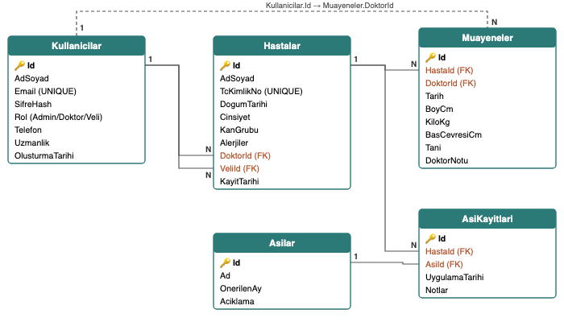

```bash
# 1) Veritabanını SQL betiğinden oluştur
sqlite3 PediatriTakip/pediatri.db < Database/schema.sql

# 2) Model sınıflarını ve DbContext'i veritabanından üret
cd PediatriTakip
dotnet ef dbcontext scaffold "Data Source=pediatri.db" Microsoft.EntityFrameworkCore.Sqlite \
    -o Models -c PediatriContext --context-dir Data --no-onconfiguring
```

## Kurulum ve Çalıştırma

Gereksinim: [.NET 8 SDK](https://dotnet.microsoft.com/download/dotnet/8.0)

```bash
git clone https://github.com/suedabeyzaozcan/PediatriTakip.git
cd PediatriTakip/PediatriTakip
dotnet run --urls http://localhost:5080
```

Tarayıcıda **http://localhost:5080** adresini açın.

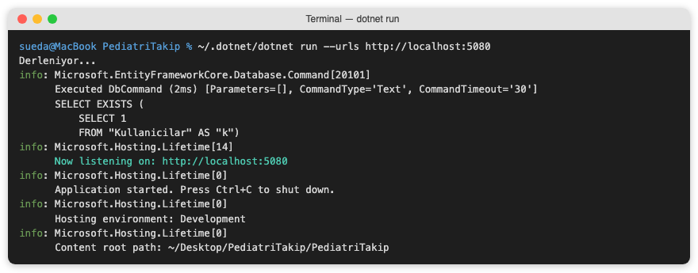

### Test hesapları

| Rol | E-posta | Şifre |
|---|---|---|
| Admin | admin@pediatri.com | Admin123! |
| Doktor | doktor@pediatri.com | Doktor123! |
| Veli | veli@pediatri.com | Veli123! |

## Ekran Görüntüleri

| Giriş | Veli Kaydı (AJAX e-posta kontrolü) |
|---|---|
| 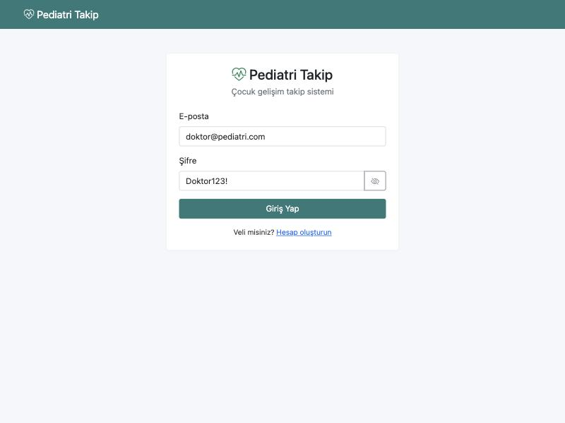 | 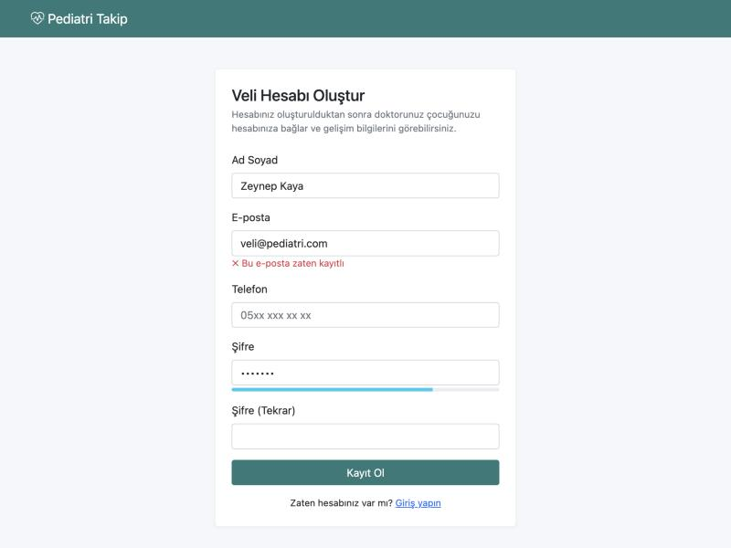 |

| Panel | Hasta Listesi (AJAX arama) |
|---|---|
| 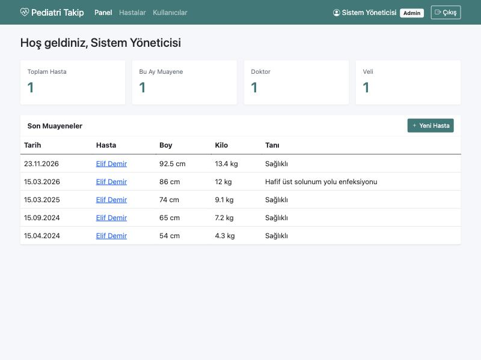 | 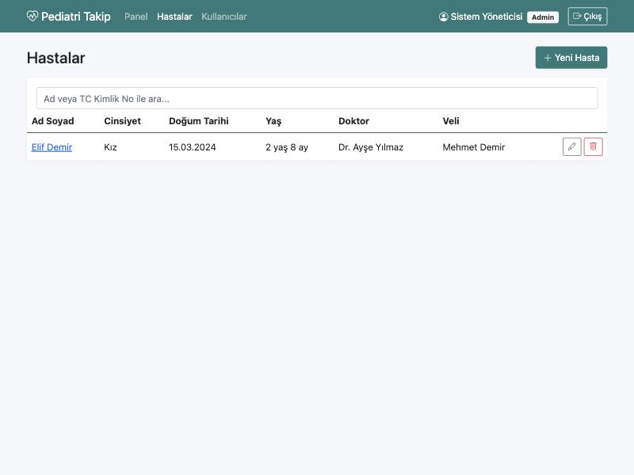 |

| Muayeneler (AJAX ekleme, VKİ) | Gelişim Grafiği |
|---|---|
| 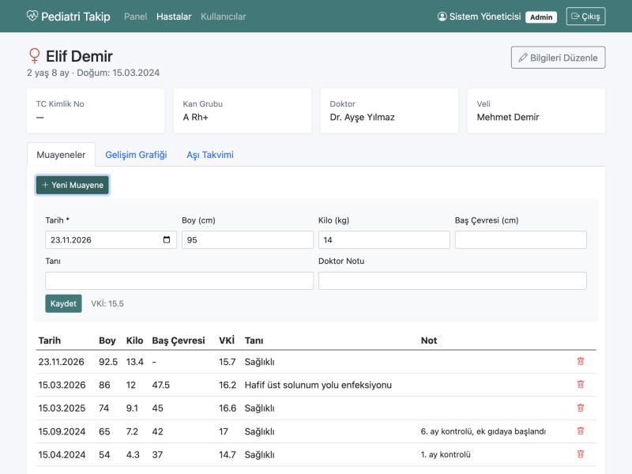 | 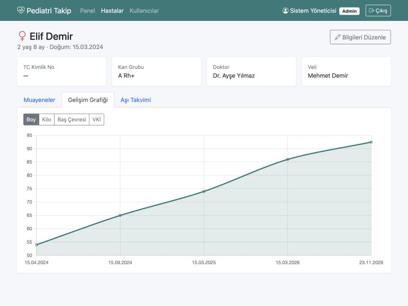 |

| Aşı Takvimi | Kullanıcı Yönetimi (Admin) |
|---|---|
| 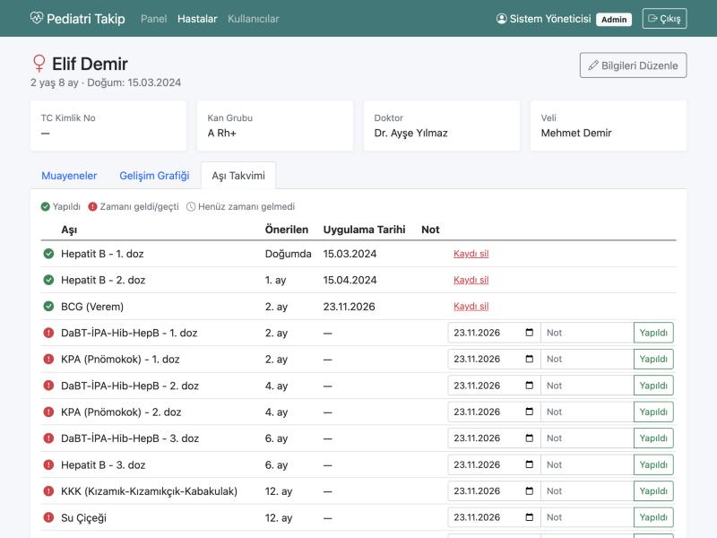 | 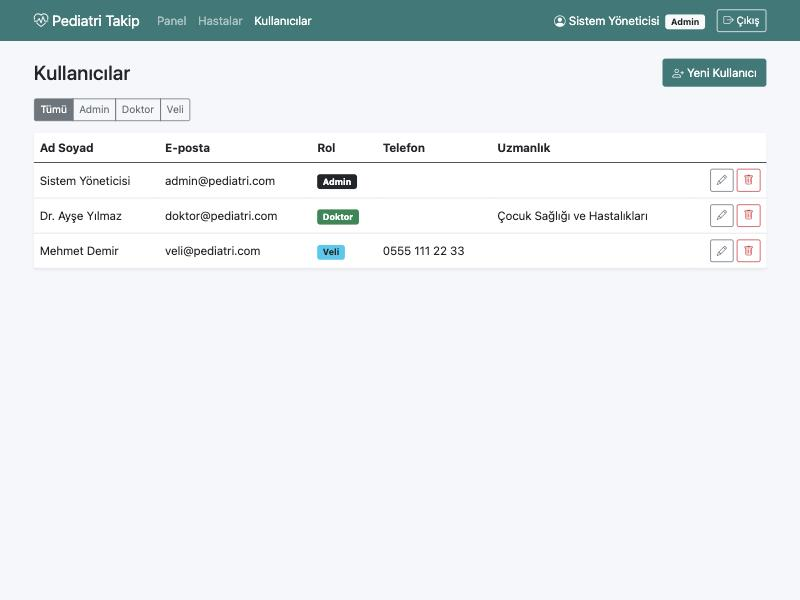 |

| Veli – Çocuklarım | Yetkisiz Erişim |
|---|---|
| 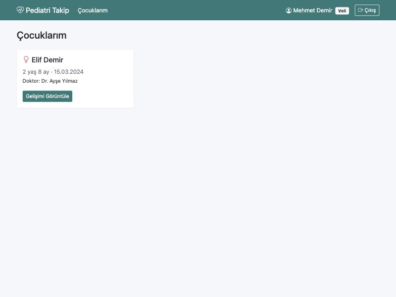 | 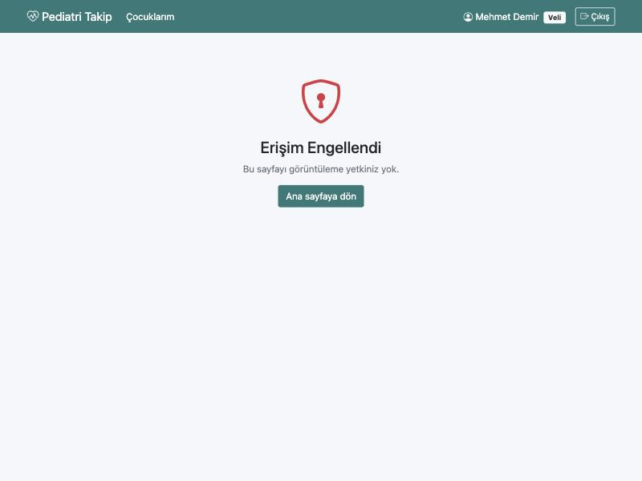 |

## Proje Yapısı

```
├── Database/schema.sql        Veritabanı tasarımı (SQL)
├── docs/                      Diyagram ve ekran görüntüleri
└── PediatriTakip/
    ├── Controllers/           Hesap, Home, Hasta, Muayene, Kullanici, Temel (ortak yetki)
    ├── Models/                Scaffold edilen varlıklar + ViewModels
    ├── Data/                  PediatriContext (scaffold)
    ├── Helpers/               Şifre hash, yaş hesaplama
    ├── Views/                 Razor sayfaları (Bootstrap)
    ├── wwwroot/               CSS, JS (jQuery / AJAX)
    └── pediatri.db            SQLite veritabanı
```

## JavaScript DOM / jQuery / AJAX Senaryoları

- **AJAX:** canlı hasta arama · kayıtta e-posta kontrolü · muayene ekleme/silme · aşı kaydı ekleme/silme · hasta ve kullanıcı silme · grafik verisi
- **DOM:** şifre göster/gizle · şifre gücü çubuğu · doğum tarihinden yaş önizleme · VKİ önizleme · role göre form alanı gösterme
- **jQuery:** event delegation, `slideToggle`, `fadeOut`, toast bildirimleri
